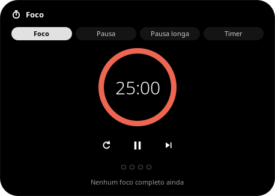
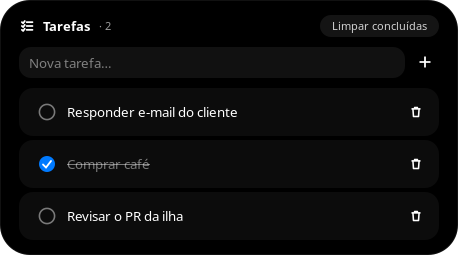
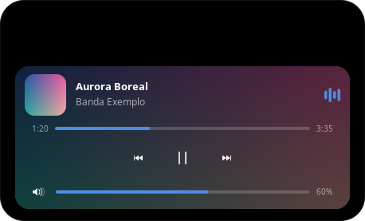
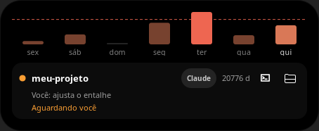
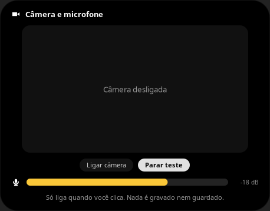

# Linux Island

**English** · [Português](README.md)

A "dynamic island" for the Linux desktop, in the style of the iPhone's Dynamic Island: a pill at the top of the screen that shows the time, weather and the music that is playing, and **expands** into pages with useful controls and information. Written in Python + GTK 3 with `gtk-layer-shell`.

> **Built and tested on [CachyOS](https://cachyos.org) with KDE Plasma 6 (Wayland).** Everything described here was tested in that environment, on a single machine. Other desktops may work partially (see [Compatibility](#compatibility)) but were not tested.


## What it does

**In the pill (closed):** time and date, weather, CPU usage, album art and equalizer, focus timer, today's Claude Code spend, a "PC kept awake" icon and **camera and microphone in-use icons** (app names in the tooltip). Notifications from other apps show up there for a few seconds.

**When expanded (click, hover or shortcut), pages you can reorder or hide:**

| Page | What it is for |
|---|---|
| **Home** | Clock, weather forecast and media control (any MPRIS player: Spotify, browser, VLC…). |
| **Water** | Drink-water reminder with a daily goal. |
| **Agenda** | Upcoming Google Calendar events and an alert before meetings. Optional: create events from the island. |
| **Notifications** | History of recent notifications with an unread badge. Memory only. |
| **Focus** | Pomodoro and timer, with a counter in the pill and a sound alert at the end. |
| **Tasks** | A quick task list, stored locally. |
| **Camera** | Webcam and microphone test before a call. Only turns on when you click. |
| **Bluetooth** | Paired devices, battery, connect/disconnect. Hides itself if the PC has no Bluetooth. |
| **System** | CPU, RAM, temperature, volume and audio output, network, battery/brightness (laptops), keep-awake and power buttons. |
| **Claude Code** | Token usage and cost by tool/project/model, a 7-day chart and an optional daily limit. |
| **Sessions** | Open Claude Code sessions, with a button to jump to each one's terminal. |

<p>
  
</p>
<p>
  
</p>

**Music cover:** browsers send random cover art, so when what's playing comes from a known service the island shows its logo: YouTube, WhatsApp, Twitch, Netflix and Telegram always; YouTube Music, Deezer and Apple Music show the album cover and fall back to the logo only if the player sends none. Spotify and local players keep their own cover.


**Navigation:** the bottom strip has one icon per page. The current one is highlighted, the Notifications bell turns orange when there are unread ones, and hovering shows the page name.


**Look:** built-in themes and your own (save, import and export as JSON), **automatic light/dark** (following KDE or by time of day), **KDE accent color**, a "notch" style glued to the top with an adjustable curve, glass effect with KDE blur, 5 equalizer styles, a glow or blurred background from the album art, animation speed, and a Portuguese, English and Spanish interface.

## Installation

Dependencies (Arch/CachyOS package names):

```bash
sudo pacman -S gtk3 gtk-layer-shell python-gobject python-cairo \
               libsecret gst-plugin-pipewire pipewire-pulse wireplumber networkmanager
```

* **Required:** Python 3, PyGObject, GTK 3, `gtk-layer-shell`, `python-cairo`.
* **Optional:** `libsecret` (stores tokens in the keyring), GStreamer with `pipewiresrc` (camera/microphone test), `pipewire`/`wpctl`/`pactl` (audio and camera/microphone detection), `nmcli` (network), `qdbus6` (KDE: jump to a session's terminal).

```bash
git clone https://github.com/FabioCastilho/linux-island.git
cd linux-island
./run.sh
```

To start with your session: **Settings › Behavior › Start with the session**. Settings open with a right-click on the island or with `./run.sh --settings`.

Tests: `python3 -m unittest discover -s tests`.

## Command line and shortcuts

The island is single-instance: running `run.sh` again with an option talks to the one that is already open. Great for binding to KDE shortcuts.

| Command | What it does |
|---|---|
| `--toggle` | Expand or collapse. |
| `--page NAME` | Open on a page (`home`, `water`, `agenda`, `notifs`, `focus`, `tasks`, `camera`, `bluetooth`, `system`, `claude`, `sessions`). |
| `--next-page` / `--prev-page` | Change page (the first call only opens the island). |
| `--play-pause`, `--next-track`, `--prev-track` | Media control without opening the island. |
| `--dnd` | Toggle the island's notification do-not-disturb. |
| `--focus` | Start or pause focus. |
| `--settings` | Open settings. |

## Privacy and network

There is no telemetry. What the island reads and accesses:

* **Network, only what you use:** weather from [Open-Meteo](https://open-meteo.com); **if you don't set a city, the approximate location comes from your IP via `ipwho.is`**; Spotify (optional, with your own Client ID) and Google Calendar (optional, OAuth login in the browser; **read-only by default**, and it only creates events if you turn on "Allow creating events" in Settings > Calendar. The app never edits or deletes events).
* **Tokens** are kept in the system keyring (libsecret); without a keyring, in a file with `0600` permissions.
* **Local, never sent:** notifications (D-Bus), Claude Code history and sessions (`~/.claude`, read-only), CPU/RAM/network usage.
* **Camera and microphone:** the island only turns them on for the test, when you click, and nothing is recorded. The indicator just observes PipeWire and `/proc`.
* The notification history is **memory only**. Tasks live in `~/.local/state/linux-island/tasks.json`. Errors go to `~/.local/state/linux-island/island.log`.
* **This repository ships no Google credentials.** To use the agenda, create your own (an OAuth app of type "Desktop" with the Calendar API) and save the JSON to `~/.config/linux-island/google_client_secret.json`.

## Performance cost

An estimate of what the island asks of the machine, **not** a speed benchmark. Measured on a desktop with a 16-thread Xeon CPU, CachyOS, KDE Plasma 6 (Wayland), Python 3.14. Percentages are a fraction of **one** core (100 % = one whole core) and vary with hardware.

| Situation | CPU (% of 1 core) | Memory | Source |
|---|---|---|---|
| **Baseline: idle pill, no music** | ≈ 2 % (2.4 % measured; camera detection was made lighter afterwards) | ≈ 120 MB (RSS), 9 threads | measured |
| **Home** page open | + ≈ 0.7 points | ≈ +1 MB | measured |
| **System** page open | + ≈ 5.6 points (chart, ring and readings every 1 s) | ≈ +1 MB | measured |
| **Camera/microphone** detection (every 5 s) | ≈ 0.6 % | — | bench-measured |
| Claude Code sessions (every 2 s) | ≈ 0.01 % | — | bench-measured |
| Today's Claude Code spend (every 60 s, background) | ≈ 0.004 % | — | bench-measured |
| Network and CPU reading (every 1–2 s) | ≈ 0.01 % | — | bench-measured |
| Audio and connection on the System page (`wpctl`/`nmcli`) | ≈ 0.4 % and ≈ 0.2 % only with the page open | — | bench-measured |
| **Camera test** running (15 fps, 384×216) | ≈ 6.6 % only while running | — | measured |
| **Microphone test** running | ≈ 2.5 % only while running | — | measured |
| Animated equalizer (music playing) | low, not measured (redrawing a small widget at ~24 frames/s) | — | **estimated** |
| Bluetooth (BlueZ) | negligible: only reacts to D-Bus events; **not tested on hardware** | — | **estimated** |

"Bench-measured" costs are each task's CPU time divided by the interval it runs at. Most of the idle consumption is the GTK event loop and redrawing, not the readings.

## Compatibility

* **Tested:** CachyOS (Arch-based), KDE Plasma 6.x / KWin 6.8 (Wayland), PipeWire. One machine, a desktop with no battery and no Bluetooth.
* **Needs Wayland with `wlr-layer-shell`** (KDE, Sway, Hyprland…). **GNOME/Mutter does not provide that protocol**, so it does not work there.
* **KDE-specific:** background blur (`org_kde_kwin_blur` protocol), jumping to a session's terminal (KWin script via `qdbus6`), automatic theme and accent color (read `~/.config/kdeglobals`). Without KDE these features simply have no effect.
* **Not tested on real hardware:** the Bluetooth page, brightness and battery (laptops). The logic is tested with simulated data.

## License and credits

MIT, see [LICENSE](LICENSE).

This project is based on [linux-island](https://github.com/mrlazarias/linux-island) by **Murilo Azarias** (also MIT), whose copyright notice has been kept, and includes modifications and additional features over the original. It was developed with the help of [Claude Code](https://claude.com/claude-code).
