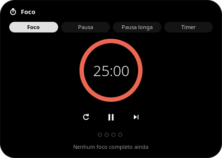
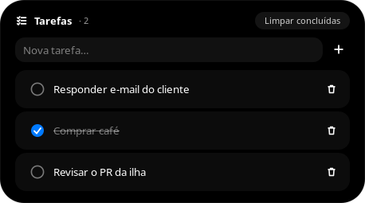
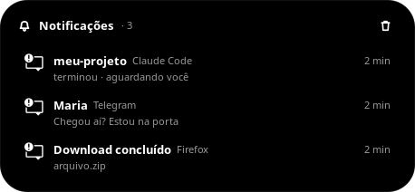
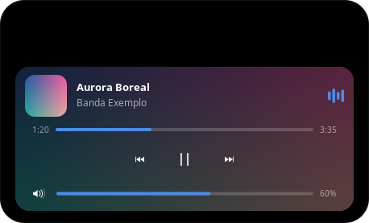
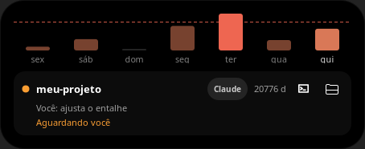
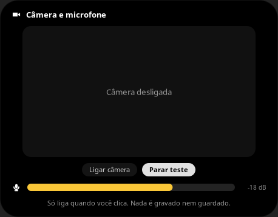

# Linux Island

[English](README.en.md) · **Português**

Uma "ilha dinâmica" para o desktop Linux, no estilo da Dynamic Island do iPhone: uma pílula no topo da tela que mostra hora, clima e a música que está tocando, e **expande** para páginas com controles e informações úteis. Feita em Python + GTK 3 com `gtk-layer-shell`.

> **Feita e testada no [CachyOS](https://cachyos.org) com KDE Plasma 6 (Wayland).** Tudo o que está descrito aqui foi testado nesse ambiente, em uma única máquina. Outros desktops podem funcionar parcialmente (veja [Compatibilidade](#compatibilidade)), mas não foram testados.


## O que ela faz

**Na pílula (fechada):** hora e data, clima, uso de CPU, capa e equalizador da música, contador do foco, gasto do dia no Claude Code, ícone de "PC mantido acordado" e **ícones de câmera e microfone em uso** (com o nome dos apps no tooltip). Notificações de outros apps aparecem ali por alguns segundos.

**Ao expandir (clique, passar o mouse ou atalho), páginas que você pode reordenar ou esconder:**

| Página | Para que serve |
|---|---|
| **Início** | Relógio, previsão do tempo e controle de mídia (qualquer player MPRIS: Spotify, navegador, VLC…). |
| **Água** | Lembrete de beber água com meta diária. |
| **Agenda** | Próximos eventos do Google Calendar e aviso antes das reuniões. Opcional: criar eventos pela ilha. |
| **Notificações** | Histórico das últimas notificações, com selo de não lidas. Só na memória. |
| **Foco** | Pomodoro e timer, com contador na pílula e aviso com som no fim. |
| **Tarefas** | Lista rápida de tarefas, salva localmente. |
| **Câmera** | Teste de webcam e de microfone antes de uma chamada. Só liga quando você clica. |
| **Bluetooth** | Dispositivos pareados, bateria e conectar/desconectar. Some sozinha se o PC não tem Bluetooth. |
| **Sistema** | CPU, RAM, temperatura, volume e saída de áudio, rede, bateria/brilho (notebooks), manter acordado e botões de energia. |
| **Claude Code** | Uso de tokens e custo por função/projeto/modelo, gráfico de 7 dias e limite diário opcional. |
| **Sessões** | Sessões do Claude Code abertas, com botão para ir ao terminal de cada uma. |

<p>
  
</p>
<p>
  
</p>

**Capa da música:** navegadores mandam capas aleatórias, então, quando o que toca vem de um serviço conhecido, a ilha mostra a logo dele: YouTube, WhatsApp, Twitch, Netflix e Telegram sempre; YouTube Music, Deezer e Apple Music mostram a capa do álbum e usam a logo só se o player não mandar capa. Álbuns do Spotify e de players locais seguem com a própria capa.


**Navegação:** a faixa de baixo tem um ícone por página. A atual fica destacada, o sino de Notificações fica laranja quando há não lidas, e passar o mouse mostra o nome da página.


**Aparência:** temas embutidos e temas seus (salvar, importar e exportar em JSON), **claro/escuro automático** (seguindo o KDE ou por horário), **cor de destaque do KDE**, estilo "entalhe" colado no topo com curva ajustável, efeito vidro com desfoque do KDE, 5 estilos de equalizador, brilho ou fundo desfocado a partir da capa do álbum, velocidade das animações e interface em português, inglês e espanhol.

## Instalação

Dependências (nomes dos pacotes no Arch/CachyOS):

```bash
sudo pacman -S gtk3 gtk-layer-shell python-gobject python-cairo \
               libsecret gst-plugin-pipewire pipewire-pulse wireplumber networkmanager
```

* **Obrigatórios:** Python 3, PyGObject, GTK 3, `gtk-layer-shell`, `python-cairo`.
* **Opcionais:** `libsecret` (guarda tokens no chaveiro), GStreamer com `pipewiresrc` (teste de câmera/microfone), `pipewire`/`wpctl`/`pactl` (áudio e detecção de câmera/microfone), `nmcli` (rede), `qdbus6` (KDE: ir ao terminal de uma sessão).

```bash
git clone https://github.com/FabioCastilho/linux-island.git
cd linux-island
./run.sh
```

Para abrir junto com a sessão: **Configurações › Comportamento › Iniciar com a sessão**. As configurações abrem com o botão direito na ilha ou com `./run.sh --settings`.

Testes: `python3 -m unittest discover -s tests`.

## Linha de comando e atalhos

A ilha é de instância única: rodar `run.sh` de novo com uma opção fala com a que já está aberta. Ótimo para ligar a atalhos do KDE.

| Comando | O que faz |
|---|---|
| `--toggle` | Expande ou recolhe. |
| `--page NOME` | Abre numa página (`home`, `water`, `agenda`, `notifs`, `focus`, `tasks`, `camera`, `bluetooth`, `system`, `claude`, `sessions`). |
| `--next-page` / `--prev-page` | Troca de página (a primeira chamada só abre a ilha). |
| `--play-pause`, `--next-track`, `--prev-track` | Controle de mídia sem abrir a ilha. |
| `--dnd` | Liga/desliga o não perturbe das notificações da ilha. |
| `--focus` | Inicia ou pausa o foco. |
| `--settings` | Abre as configurações. |

## Privacidade e rede

Não há telemetria. O que a ilha lê e acessa:

* **Rede, só o que você usa:** clima pela [Open-Meteo](https://open-meteo.com); **se você não informar a cidade, a localização aproximada vem do IP via `ipwho.is`**; Spotify (opcional, com o seu Client ID) e Google Calendar (opcional, login OAuth no navegador; **somente leitura por padrão**, e só cria eventos se você ligar "Permitir criar eventos" em Configurações > Agenda. O app nunca edita nem apaga eventos).
* **Tokens** ficam no chaveiro do sistema (libsecret); sem chaveiro, num arquivo com permissão `0600`.
* **Local, nunca enviado:** as notificações (D-Bus), o histórico e as sessões do Claude Code (`~/.claude`, somente leitura), o uso de CPU/RAM/rede.
* **Câmera e microfone:** a ilha só os liga no teste, quando você clica, e nada é gravado. O indicador apenas observa o PipeWire e o `/proc`.
* O histórico de notificações fica **só na memória**. As tarefas ficam em `~/.local/state/linux-island/tasks.json`. Erros vão para `~/.local/state/linux-island/island.log`.
* **Este repositório não traz credenciais do Google.** Para usar a agenda, crie as suas (app OAuth do tipo "Desktop" com a API do Calendar) e salve o JSON em `~/.config/linux-island/google_client_secret.json`.

## Custo de desempenho

Estimativa do que a ilha pede da máquina, **não** um teste de velocidade. Medido em um desktop com CPU Xeon de 16 threads, CachyOS, KDE Plasma 6 (Wayland), Python 3.14. Os percentuais são a fração de **um** núcleo (100 % = um núcleo inteiro) e variam com o hardware.

| Situação | CPU (% de 1 núcleo) | Memória | Origem |
|---|---|---|---|
| **Base: pílula parada, sem música** | ≈ 2 % (2,4 % medido; a detecção de câmera depois ficou mais leve) | ≈ 120 MB (RSS), 9 threads | medido |
| Página **Início** aberta | + ≈ 0,7 pontos | ≈ +1 MB | medido |
| Página **Sistema** aberta | + ≈ 5,6 pontos (gráfico, anel e leituras a cada 1 s) | ≈ +1 MB | medido |
| Detecção de **câmera/microfone** (a cada 5 s) | ≈ 0,6 % | — | medido em bancada |
| Sessões do Claude Code (a cada 2 s) | ≈ 0,01 % | — | medido em bancada |
| Gasto do dia do Claude Code (a cada 60 s, em segundo plano) | ≈ 0,004 % | — | medido em bancada |
| Leitura de rede e CPU (a cada 1–2 s) | ≈ 0,01 % | — | medido em bancada |
| Áudio e conexão na página Sistema (`wpctl`/`nmcli`) | ≈ 0,4 % e ≈ 0,2 % só com a página aberta | — | medido em bancada |
| **Teste de câmera** ligado (15 fps, 384×216) | ≈ 6,6 % só enquanto ligado | — | medido |
| **Teste de microfone** ligado | ≈ 2,5 % só enquanto ligado | — | medido |
| Equalizador animado (música tocando) | baixo, não medido (redesenho de um widget pequeno a ~24 quadros/s) | — | **estimado** |
| Bluetooth (BlueZ) | desprezível: só reage a eventos do D-Bus; **sem teste em hardware** | — | **estimado** |

Os custos "em bancada" são o tempo de CPU de cada tarefa dividido pelo intervalo em que ela roda. A maior parte do consumo em repouso é o laço de eventos e o redesenho do GTK, não as leituras.

## Compatibilidade

* **Testado:** CachyOS (base Arch), KDE Plasma 6.x / KWin 6.8 (Wayland), PipeWire. Uma máquina, desktop sem bateria e sem Bluetooth.
* **Precisa de Wayland com `wlr-layer-shell`** (KDE, Sway, Hyprland…). **GNOME/Mutter não oferece esse protocolo**, então não funciona lá.
* **Específico do KDE:** desfoque do fundo (protocolo `org_kde_kwin_blur`), ir ao terminal de uma sessão (script do KWin via `qdbus6`), tema automático e cor de destaque (leem o `~/.config/kdeglobals`). Sem KDE, esses recursos simplesmente não fazem efeito.
* **Sem teste em hardware real:** a página Bluetooth, o brilho e a bateria (notebooks). A lógica é testada com dados simulados.

## Licença e créditos

MIT, veja [LICENSE](LICENSE).

Este projeto é baseado no [linux-island](https://github.com/mrlazarias/linux-island) de **Murilo Azarias** (também MIT), cujo aviso de copyright foi mantido, e traz modificações e recursos adicionais em relação ao original. Foi desenvolvido com a ajuda do [Claude Code](https://claude.com/claude-code).
